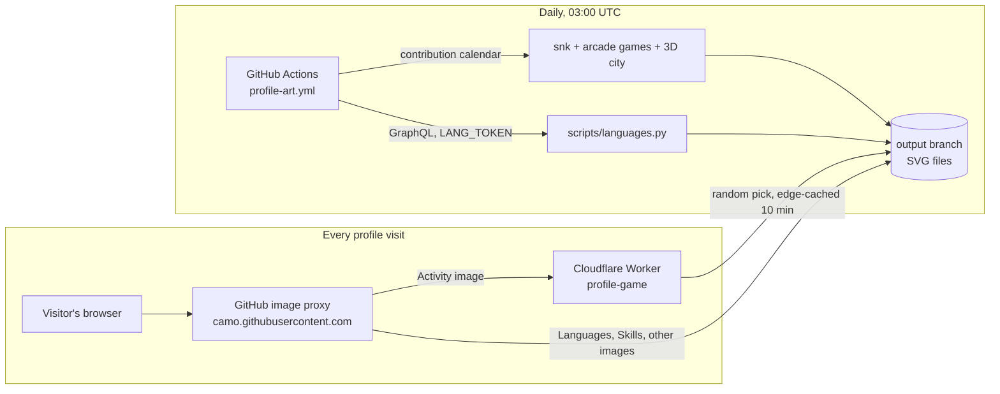

# 02 - Architecture

Three parts, each doing one job:

1. **Generator** (GitHub Actions, once a day): reads my contribution calendar and repository languages,
   draws SVG files, and commits them to the `output` branch.
2. **Storage** (the `output` branch, served by `raw.githubusercontent.com`): plain static SVG files.
3. **Picker** (Cloudflare Worker): on every image request, chooses one of the six game SVGs at random
   and streams it back without caching.

The README itself only contains `` tags. GitHub does not let a README run code, so anything dynamic
has to happen on a server behind an image URL.

## Request path of the Activity image

1. The visitor opens github.com/StefanMarinkov05. GitHub renders `README.md`.
2. GitHub rewrites every external image URL to its proxy, `camo.githubusercontent.com/<hash>`, so the
   visitor's browser never talks to my server directly (privacy, mixed content).
3. The browser asks camo for the image. Camo asks the worker,
   `https://profile-game.stefanmarinkov.workers.dev/` (or `?theme=dark` for the dark-mode `<source>`).
4. The worker draws a random number, picks a game, fetches that SVG from the `output` branch (from
   Cloudflare's edge cache when it has a copy younger than 10 minutes), and returns it with
   `Cache-Control: no-cache, no-store`.
5. Because of that header, camo does not keep the image either, so the next visit repeats steps 3-4 and
   gets a new pick.

Verified on 2026-11-22: 8 requests to the camo URL returned 4 different games.

## Why this split

- **Static generation is slow and rate-limited** (the game actions call the GitHub API and take about a
  minute). Doing it once a day and storing the result keeps every visit fast.
- **Randomness has to happen per request,** which only a server can do. The worker is a few lines and does
  no drawing; it only chooses and forwards.
- **Each part fails on its own.** If the worker is down, only the Activity image breaks. If the workflow
  fails, yesterday's SVGs stay in place.
