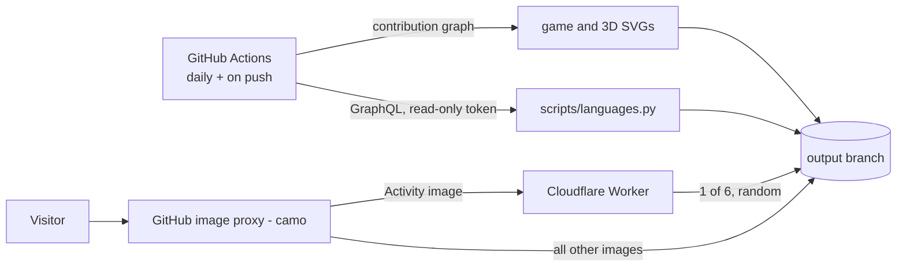

# Profile engineering

**Problem.** A GitHub profile README is static Markdown: GitHub strips CSS, JavaScript and iframes. I wanted
three things it cannot do natively: a themed design, a language breakdown that includes private repositories,
and an animation that changes on every visit.

**Solution.** Everything visual is an image. A daily GitHub Actions job renders SVGs into an `output` branch;
a Cloudflare Worker serves one of them at random per request. The README only contains `` tags.



## Design decisions

| Constraint | Decision | Why |
|---|---|---|
| No CSS, no dark-mode styling | Hand-written SVG cards, switched with `<picture>` + `prefers-color-scheme` | Only theme mechanism GitHub allows |
| Public stats services see public repos only | Own GraphQL scan with a fine-grained token, **Metadata: read-only** | Counts private repos; the token cannot read code. Only language names and percentages are published |
| No code runs in a README | Per-request randomness in a Cloudflare Worker behind an image URL | Smallest possible server: picks a file, no rendering. Free tier, no cold start |
| GitHub's proxy caches images | Worker returns `Cache-Control: no-store` | Proxy refetches each view; verified 8 fetches -> 4 different games |
| Rendering is slow and API-limited | Render once a day, store static files | Visits stay fast; a failed run keeps yesterday's files |
| Worker fetches large SVGs (50-750 KB) | Edge cache upstream files 10 min | The pick stays random, the files are not refetched |

Randomness: `crypto.getRandomValues` mod 6, uniform (bias 1/2^32). Forks are excluded from the language
scan because their code is not mine.

## Rebuild from zero

The repository contains all code. These parts live **outside** it and must be recreated:

1. **Token.** GitHub, Settings, Developer settings, fine-grained token: repository access "All repositories",
   then add **Metadata: read-only** explicitly. Without an added permission GitHub saves the token with
   *no* repository access and the card silently shows public repos only.
   Store it as Actions secret `LANG_TOKEN` in this repository.
2. **Output branch.** `gh workflow run profile-art.yml`. Creates `output`; the README and the worker read
   from it. Check the log line `N repos, M languages` (N = own non-fork repos).
3. **Cloudflare.** Free account (login via GitHub). In `worker/`: `npx wrangler@4 login`, then
   `npx wrangler@4 deploy`. A new account first needs a workers.dev subdomain (dashboard, or
   `PUT /accounts/{id}/workers/subdomain`); DNS for a new subdomain takes about 2 minutes.
4. **URLs.** If the subdomain differs from `stefanmarinkov`, update the two worker URLs in `README.md`.

Verify:

```sh
curl -sI https://profile-game.stefanmarinkov.workers.dev | grep -iE 'x-game|cache-control'   # pick + no-store
curl -sI 'https://profile-game.stefanmarinkov.workers.dev?game=snake'                          # forced pick
```

Then load the profile a few times: the Activity game should change.

## Contracts (do not break)

- File names in `output/` are shared by three parts: the game action writes `<game>-contribution-graph{,-dark}.svg`
  (snake: `github-snake{,-dark}.svg`), the worker's `GAMES` map reads them, the README links the rest.
- The worker must keep `no-store`, or every visitor sees the same cached game.
- SVGs must be self-contained: an image may animate but cannot load scripts or other files.
- The workflow skips the languages step when `LANG_TOKEN` is missing, so the job never fails on it.
- Fallback if the worker goes away: point the README to `output/activity.svg` (workflow picks
  `floor(unix_time / 10800) mod 6`, one game per 3 hours).

## Limits

| Part | Limit |
|---|---|
| Cloudflare Workers free | 100,000 requests/day, 10 ms CPU/request |
| GitHub Actions | free for public repos, about 2 min/day used |
| Browser | an open tab may keep the image; a reload gets a new pick |
