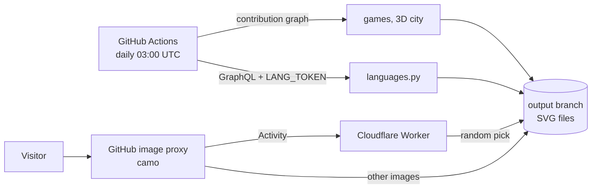

# Profile engineering

A README cannot run CSS or JavaScript; GitHub strips both. Every visual is therefore an image: static SVGs
generated daily, plus one served dynamically by a Cloudflare Worker.



## UI elements

| Element | Source | Theme handling |
|---|---|---|
| Skills card | `assets/skills-{dark,light}.svg`, hand-written | `<picture>` + `prefers-color-scheme` |
| Projects | `<details>` blocks, shields.io badges | native |
| Languages | `scripts/languages.py` -> `output/languages{,-dark}.svg` | `<picture>` |
| Activity game | Worker -> `output/<game>-contribution-graph{,-dark}.svg` | `?theme=dark` |

Generator: `.github/workflows/profile-art.yml` (daily, on push, manual). Actions: `Platane/snk` (snake),
`abozanona/pacman-contribution-graph` (Pac-Man, Galaga, Breakout, Puzzle Bobble, Bomberman),
`yoshi389111/github-profile-3d-contrib`. Result is force-pushed to the `output` branch.

## Randomization (Cloudflare Worker)

`worker/src/index.js`, live at `https://profile-game.stefanmarinkov.workers.dev`.

```js
const game = names[crypto.getRandomValues(new Uint32Array(1))[0] % names.length]; // 6 games
```

- Uniform, p = 1/6 per game. Modulo bias 1/2^32, negligible.
- Response header `Cache-Control: no-store`, so GitHub's proxy (camo) refetches on every view. Without it,
  camo caches the first pick for everyone.
- Upstream SVGs cached at Cloudflare's edge for 10 min (`cf.cacheTtl: 600`): the pick is fresh, the files are not refetched.
- `?game=<name>` forces one game; response header `x-game` shows the pick.
- Why a worker: per-request randomness needs a server. Cloudflare free tier: no cold start, no card on file.
- Fallback without the worker: the workflow writes `output/activity.svg`, chosen by `floor(unix_time / 10800) mod 6`.

## Private repositories in the languages card

The public `github-readme-stats` card sees public repositories only. `scripts/languages.py` instead:

1. Queries GraphQL `viewer.repositories(ownerAffiliations: OWNER, isFork: false)`, 100 per page, with
   language sizes in bytes.
2. Sums bytes per language; skips markup, styles, build files and TeX.
3. Renders the top 6 as a share of those 6.

Token: secret `LANG_TOKEN`, fine-grained, all repositories, **Metadata: read-only** only. It reads names and
language sizes, never code. Only language names and percentages are published. Forks are excluded (not my code).

Pitfall: "All repositories" without an explicit permission saves a token with no repository access.

## Changes

| Change | How |
|---|---|
| Text, projects | edit `README.md` |
| Skill keyword | both `assets/skills-*.svg` + `alt` in `README.md` |
| Regenerate now | `gh workflow run profile-art.yml` |
| Games in the pick | `GAMES` in `worker/src/index.js`, then `npx wrangler@4 deploy` in `worker/` |
| Check the worker | `curl -sI https://profile-game.stefanmarinkov.workers.dev \| grep x-game` |

Workflow: branch, PR, merge to `main`.

## Limits

| Part | Limit |
|---|---|
| README | no CSS, no JS, no iframes; images, `<picture>`, `<details>`, Mermaid allowed |
| SVG as image | animation yes, scripts and external files no |
| Cloudflare Workers (free) | 100,000 requests/day, 10 ms CPU/request |
| GitHub Actions | free for public repos; about 2 min/day used |
| Browser cache | an open tab may keep the image; a reload fetches a new pick |
