# 🧪 Profile playground

Every widget, trick and easter egg I could find that GitHub allows, live, with its code. Copy what you like into the main `README.md`.

**Rules of the game:** GitHub strips `<style>`, `<script>` and `style=""` from READMEs, so no custom CSS. Styling works only through
**images** (SVG may contain its own CSS animation), a small HTML set (`<details>`, `<picture>`, `align`, `width`, `<kbd>`)
and GitHub's own blocks (Mermaid, maps, 3D models). The animated graphics below are redrawn daily by
`.github/workflows/profile-art.yml` into the `output` branch.

> [!TIP]
> Recruiters skim a profile in under a minute. One animation plus one hidden easter egg reads as fun; five read as a template.

## 1. Custom banners (own SVGs in `scratchpad/banners/`, edit freely)

### Minimal

Name, animated underline, one line. Calm. In the main README use the path `scratchpad/banners/minimal.svg`.


<details><summary>📋 code</summary>

```html

```

</details>

### Terminal

Lines type out in a terminal window. In the main README use the path `scratchpad/banners/terminal.svg`.


<details><summary>📋 code</summary>

```html

```

</details>

### Aurora

Moving blurred colour blobs behind the name. In the main README use the path `scratchpad/banners/aurora.svg`.


<details><summary>📋 code</summary>

```html

```

</details>

### Glitch

Cyberpunk glitch every few seconds; fits the security angle. In the main README use the path `scratchpad/banners/glitch.svg`.


<details><summary>📋 code</summary>

```html

```

</details>

## 2. Contribution graph games (generated daily)

### Snake (current)

<picture>
  <source media="(prefers-color-scheme: dark)" srcset="https://raw.githubusercontent.com/StefanMarinkov05/StefanMarinkov05/output/github-snake-dark.svg" />
  
</picture>

<details><summary>📋 code</summary>

```html
<picture>
  <source media="(prefers-color-scheme: dark)" srcset="https://raw.githubusercontent.com/StefanMarinkov05/StefanMarinkov05/output/github-snake-dark.svg" />
  
</picture>
```

</details>

### Snake, ocean colours


<details><summary>📋 code</summary>

```html

```

</details>

### Snake, lava colours


<details><summary>📋 code</summary>

```html

```

</details>

### Pac-Man

<picture>
  <source media="(prefers-color-scheme: dark)" srcset="https://raw.githubusercontent.com/StefanMarinkov05/StefanMarinkov05/output/pacman-contribution-graph-dark.svg" />
  
</picture>

<details><summary>📋 code</summary>

```html
<picture>
  <source media="(prefers-color-scheme: dark)" srcset="https://raw.githubusercontent.com/StefanMarinkov05/StefanMarinkov05/output/pacman-contribution-graph-dark.svg" />
  
</picture>
```

</details>

### Galaga (spaceship shoots your commits)

<picture>
  <source media="(prefers-color-scheme: dark)" srcset="https://raw.githubusercontent.com/StefanMarinkov05/StefanMarinkov05/output/galaga-contribution-graph-dark.svg" />
  
</picture>

<details><summary>📋 code</summary>

```html
<picture>
  <source media="(prefers-color-scheme: dark)" srcset="https://raw.githubusercontent.com/StefanMarinkov05/StefanMarinkov05/output/galaga-contribution-graph-dark.svg" />
  
</picture>
```

</details>

### Breakout

<picture>
  <source media="(prefers-color-scheme: dark)" srcset="https://raw.githubusercontent.com/StefanMarinkov05/StefanMarinkov05/output/breakout-contribution-graph-dark.svg" />
  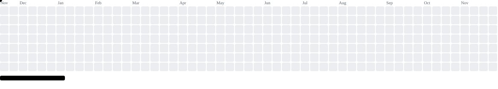
</picture>

<details><summary>📋 code</summary>

```html
<picture>
  <source media="(prefers-color-scheme: dark)" srcset="https://raw.githubusercontent.com/StefanMarinkov05/StefanMarinkov05/output/breakout-contribution-graph-dark.svg" />
  
</picture>
```

</details>

### Puzzle Bobble

<picture>
  <source media="(prefers-color-scheme: dark)" srcset="https://raw.githubusercontent.com/StefanMarinkov05/StefanMarinkov05/output/puzzle-bobble-contribution-graph-dark.svg" />
  
</picture>

<details><summary>📋 code</summary>

```html
<picture>
  <source media="(prefers-color-scheme: dark)" srcset="https://raw.githubusercontent.com/StefanMarinkov05/StefanMarinkov05/output/puzzle-bobble-contribution-graph-dark.svg" />
  
</picture>
```

</details>

### Bomberman

<picture>
  <source media="(prefers-color-scheme: dark)" srcset="https://raw.githubusercontent.com/StefanMarinkov05/StefanMarinkov05/output/bomberman-contribution-graph-dark.svg" />
  
</picture>

<details><summary>📋 code</summary>

```html
<picture>
  <source media="(prefers-color-scheme: dark)" srcset="https://raw.githubusercontent.com/StefanMarinkov05/StefanMarinkov05/output/bomberman-contribution-graph-dark.svg" />
  
</picture>
```

</details>

## 3. 3D contribution city (generated daily)

### Night rainbow

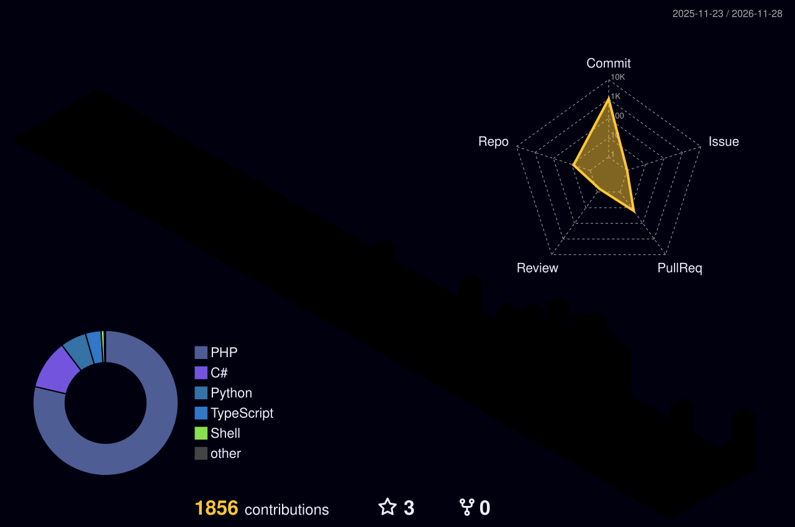

<details><summary>📋 code</summary>

```html

```

</details>

### Green, animated

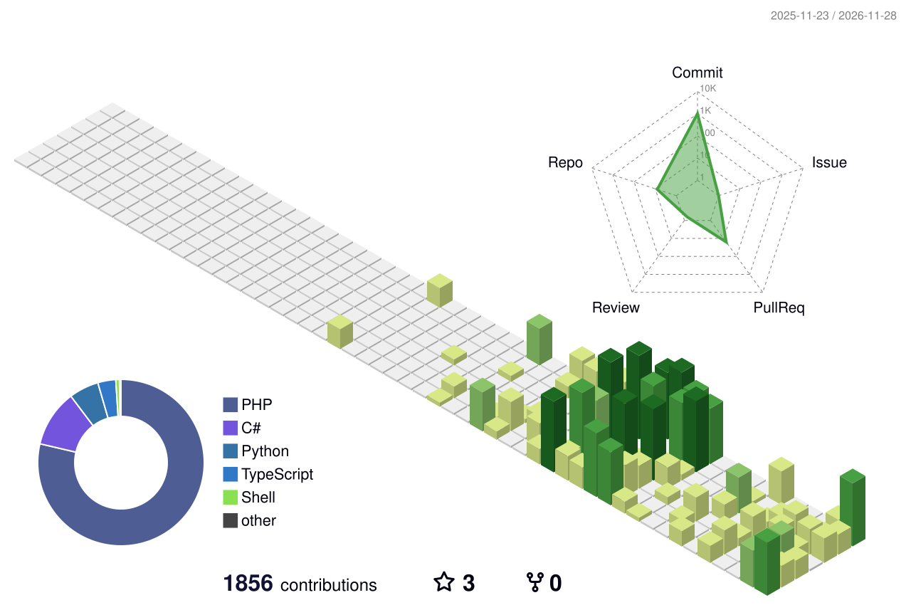

<details><summary>📋 code</summary>

```html

```

</details>

### Seasons, animated

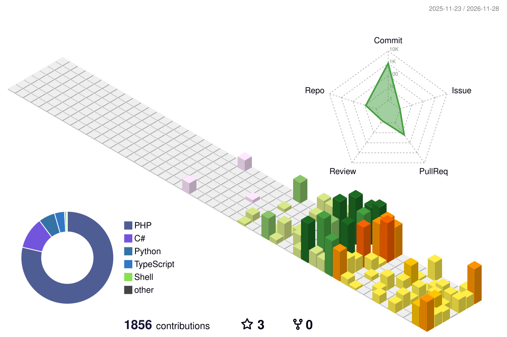

<details><summary>📋 code</summary>

```html

```

</details>

### Night view

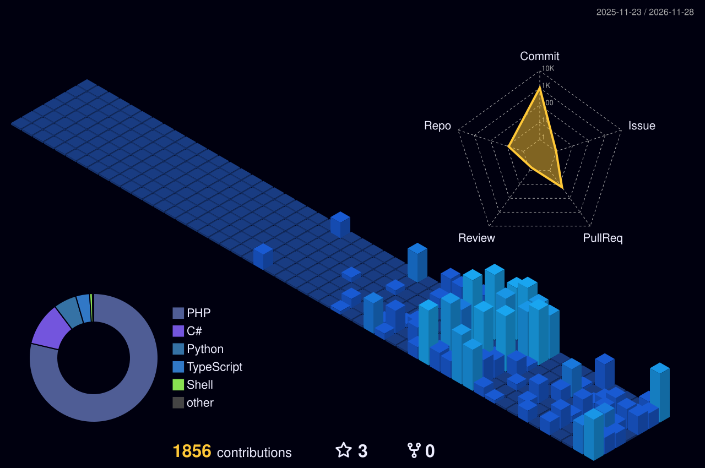

<details><summary>📋 code</summary>

```html

```

</details>

### Git blocks

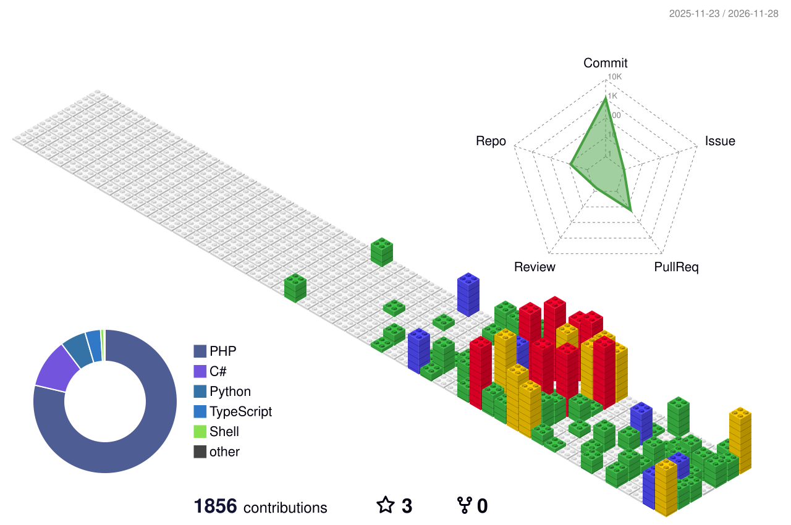

<details><summary>📋 code</summary>

```html

```

</details>

## 4. Hosted header generators

### Waving


<details><summary>📋 code</summary>

```html

```

</details>

### Venom


<details><summary>📋 code</summary>

```html

```

</details>

### Shark


<details><summary>📋 code</summary>

```html

```

</details>

### Footer wave (put at the bottom)


<details><summary>📋 code</summary>

```html

```

</details>

### Typing text (what was there before)

Most copied widget on GitHub; reads as template unless the lines say something only you would say.


<details><summary>📋 code</summary>

```html

```

</details>

## 5. Stats cards

### Stats

⚠️ Counts public activity only; currently shows rank C+.


<details><summary>📋 code</summary>

```html

```

</details>

### Top languages


<details><summary>📋 code</summary>

```html

```

</details>

### Streak


<details><summary>📋 code</summary>

```html

```

</details>

### Activity graph


<details><summary>📋 code</summary>

```html

```

</details>

### Profile summary


<details><summary>📋 code</summary>

```html

```

</details>

## 6. Badges and icons

### Skill icons, dark


<details><summary>📋 code</summary>

```html

```

</details>

### Skill icons, light


<details><summary>📋 code</summary>

```html

```

</details>

### Badge styles

    

<details><summary>📋 code</summary>

```html
    
```

</details>

### Profile view counter

Counts every view, including yours and this page's.


<details><summary>📋 code</summary>

```html

```

</details>

## 7. Random fun cards (new content on each load)

### Dev joke


<details><summary>📋 code</summary>

```html

```

</details>

### Dev quote


<details><summary>📋 code</summary>

```html

```

</details>

## 8. Easter eggs

### Light/dark mode secret

Different message depending on the viewer's theme. Switch your GitHub theme to see the other one.

<picture>
  <source media="(prefers-color-scheme: dark)" srcset="easter-eggs/mode-dark.svg" />
  
</picture>

<details><summary>📋 code</summary>

```html
<picture>
  <source media="(prefers-color-scheme: dark)" srcset="easter-eggs/mode-dark.svg" />
  
</picture>
```

</details>

### Click to open

<details>
<summary>🥚</summary>

You found it. Most people never click the egg.

</details>

<details><summary>📋 code</summary>

```html
<details>
<summary>🥚</summary>

You found it. Most people never click the egg.

</details>
```

</details>

### Hidden comment (only visible in the source)

<!-- If you are reading the raw README: hi, you are exactly the kind of person I like working with. -->
<sub>👀 something is hidden in the source of this section</sub>

<details><summary>📋 code</summary>

```html
<!-- If you are reading the raw README: hi, you are exactly the kind of person I like working with. -->
<sub>👀 something is hidden in the source of this section</sub>
```

</details>

### Keyboard keys

Press <kbd>Ctrl</kbd> + <kbd>C</kbd> to copy, <kbd>Ctrl</kbd> + <kbd>V</kbd> to ship.

<details><summary>📋 code</summary>

```html
Press <kbd>Ctrl</kbd> + <kbd>C</kbd> to copy, <kbd>Ctrl</kbd> + <kbd>V</kbd> to ship.
```

</details>

### Tooltip on hover

Only works on desktop.

<a href="#" title="you hovered, nice">hover over me</a>

<details><summary>📋 code</summary>

```html
<a href="#" title="you hovered, nice">hover over me</a>
```

</details>

## 9. GitHub's own interactive blocks

These render natively, no service needed. Copy the whole code block including the fence.

### Timeline (Mermaid)

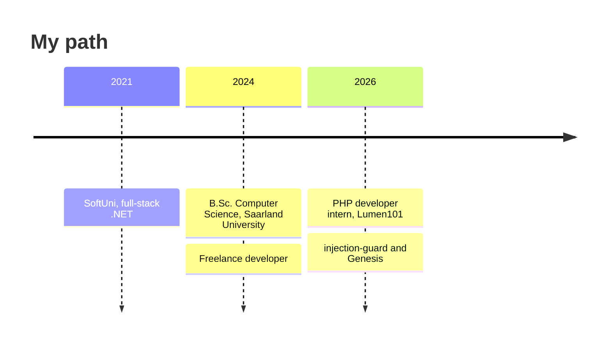

### Live map (GeoJSON, zoom and drag)

```geojson
{
  "type": "FeatureCollection",
  "features": [
    {"type": "Feature", "properties": {"name": "SoftUni, Sofia"}, "geometry": {"type": "Point", "coordinates": [23.3219, 42.6977]}},
    {"type": "Feature", "properties": {"name": "Saarland University, Saarbrücken"}, "geometry": {"type": "Point", "coordinates": [7.0418, 49.2556]}},
    {"type": "Feature", "properties": {"name": "the road"}, "geometry": {"type": "LineString", "coordinates": [[23.3219, 42.6977], [7.0418, 49.2556]]}}
  ]
}
```

### 3D model you can rotate (STL)

```stl
solid pyramid
facet normal 0 -0.707 0.707
 outer loop
  vertex 0 0 0
  vertex 10 0 0
  vertex 5 5 8
 endloop
endfacet
facet normal 0.707 0 0.707
 outer loop
  vertex 10 0 0
  vertex 10 10 0
  vertex 5 5 8
 endloop
endfacet
facet normal 0 0.707 0.707
 outer loop
  vertex 10 10 0
  vertex 0 10 0
  vertex 5 5 8
 endloop
endfacet
facet normal -0.707 0 0.707
 outer loop
  vertex 0 10 0
  vertex 0 0 0
  vertex 5 5 8
 endloop
endfacet
facet normal 0 0 -1
 outer loop
  vertex 0 0 0
  vertex 10 10 0
  vertex 10 0 0
 endloop
endfacet
facet normal 0 0 -1
 outer loop
  vertex 0 0 0
  vertex 0 10 0
  vertex 10 10 0
 endloop
endfacet
endsolid pyramid
```

### Alerts

> [!NOTE]
> Blue note.

> [!IMPORTANT]
> Purple important.

> [!WARNING]
> Orange warning.

> [!CAUTION]
> Red caution.

### Maths

$$\text{bugs}_{\text{next week}} = \text{bugs}_{\text{today}} - \text{tests written} + \text{features shipped}$$

---

Dead services (checked 2026-11-22, left out): github-profile-trophy (HTTP 402). Not generated by the art action version 5.0.0: minesweeper, tetris, arcade snake.
